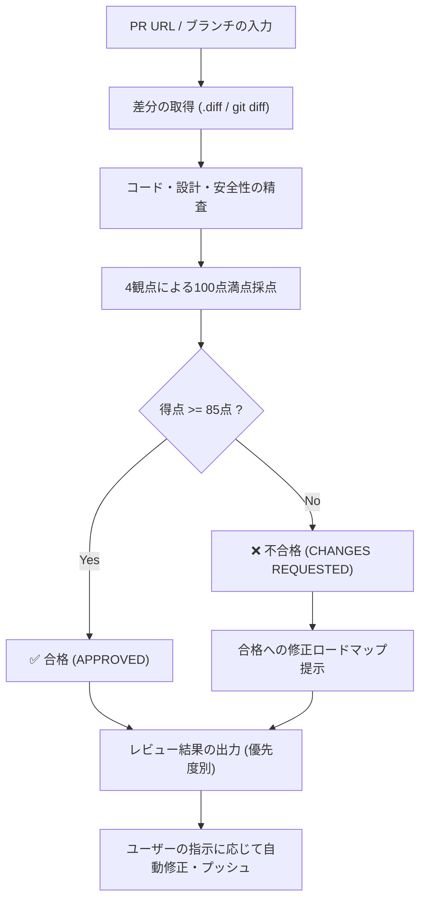

# Pull Request Review Skill (100点満点採点 & 優先度別レビュー)

GitHub プルリクエスト（PR）やローカルのブランチ差分を定量的・客観的にレビューし、**100点満点で評価（85点以上で合格）**、**対応優先度順（高・中・低）に並べた改善提案** を提供するスキルです。

---

## 1. レビュー実行フロー



### ステップ 1: 差分および PR コンテキストの取得
- PR URL（例: `https://github.com/owner/repo/pull/123`）が与えられた場合：
  1. `read_url_content` で URL 末尾に `.diff` を付与して生差分を取得する（例: `.../pull/123.diff`）。
  2. PR 本体の URL からタイトル、概要、コミット一覧、議論内容を取得して背景・意図を把握する。
- ローカル差分の場合：
  - `git diff <base_branch>...<head_branch>` を実行して差分を確認する。

### ステップ 2: 4観点による採点 (100点満点 / 85点合格)
[scoring-rubric.md](./references/scoring-rubric.md) に基づき、客観的に評価・減点します。

| 評価項目 | 配点 | 主な評価観点 |
| :--- | :---: | :--- |
| **アーキテクチャ・設計思想** | **30点** | 責務分離、モジュール分割、DDD/BDD/TDD原則、スキーマ・契約設計、拡張性、ハードコードの有無 |
| **実装の完全性・動作信頼性** | **30点** | ロジックの正確さ、無限ループ・リトライ制御、非同期処理のイベントループブロッキング、レースコンディション |
| **堅牢性・安全性** | **20点** | 権限分離・ガード機能のバイパス防止、エラーハンドリング、環境差異（Windows/Linux、文字コード CP932）耐性 |
| **ドキュメント・コード品質** | **20点** | コメント、README/仕様書との整合性、依存関係（requirements.txt 等）の直接明記、コード衛生 |

### ステップ 3: 指摘事項の優先度分類
指摘事項を以下の 3 つの優先度に分類して整理します：

- 🔴 **優先度: 高 (Must Fix - ブロッキング / 致命的バグ)**
  - 無限ループ、デッドロック、データの不整合
  - ガード機能のバイパス、セキュリティ脆弱性
  - `async def` 内での同期的ブロッキング I/O（イベントループ停止）
  - 必須依存パッケージの `requirements.txt` 未記載（起動不能）
- 🟡 **優先度: 中 (Should Fix - 信頼性・拡張性・保守性向上)**
  - レースコンディション（コンテナヘルスチェックの欠如等）
  - ハードコードされた設定値・モデル名
  - LLM 出力の Markdown サニタイズ（```markdown の除去）
  - 型定義の曖昧さ、子ワークフロー/呼び出しシグネチャの型安全性
- 🟢 **優先度: 低 (Nice to Have - 可読性・コード衛生)**
  - 不要な残骸コード、タイポ、未使用変数
  - ローカル絶対パス（`D:\...`）の相対パス化
  - `.env.example` のオプション記載充実

---

## 2. 出力フォーマット規約

エージェントは以下の標準 Markdown フォーマットでレビュー結果を出力してください。

````markdown
# 📊 総合評価

| 評価項目 | 配点 | 獲得点 |
| :--- | :---: | :---: |
| **アーキテクチャ・設計思想** | 30 | XX |
| **実装の完全性・動作信頼性** | 30 | XX |
| **堅牢性・安全性（ガード機能等）** | 20 | XX |
| **ドキュメント・コード品質** | 20 | XX |
| **合計得点** | **100** | **XX点** |

### 判定: ✅ 合格（APPROVED） または ❌ 不合格（CHANGES REQUESTED） （合格基準: 85点以上）

> **総評**:  
> [設計の長所への評価と、改善点の概要を端的に記載]

---

# 🛠 対応優先度順 レビュー指摘事項

## 🔴 優先度: 高（Must Fix）
### 1. [ファイル名]: [問題の簡潔なタイトル]
- **該当箇所**: [`path/to/file#L10-L20`](file:///path/to/file#L10-L20)
- **問題点**: [何が起きているか]
- **影響**: [なぜ重大なのか、どんな障害を引き起こすか]
- **改善案**: [具体的な修正コード例]

## 🟡 優先度: 中（Should Fix）
...

## 🟢 優先度: 低（Nice to Have）
...

---

# 🎯 合格（85点以上）への修正ロードマップ (不合格の場合のみ)
| 対応項目 | 想定加点 | 修正後の見込み得点 |
| :--- | :---: | :---: |
| **現在** | - | **XX点** |
| 1. [項目名] | +X点 | XX点 |
````

---

## 3. 修正の自動実行・プッシュ支援

ユーザーから「修正しておいて」「直してプッシュして」と依頼された場合：
1. レビューで提示した修正案を `replace_file_content` または `write_to_file` で正確に適用する。
2. 構文チェックや動作検証（`py_compile` や単体テスト）を実施して問題ないことを確認する。
3. Conventional Commits 規約に準拠したコミットメッセージを作成し、対象ブランチへプッシュする。
4. 修正後の再評価スコア（見込み得点）を提示して完了報告を行う。
