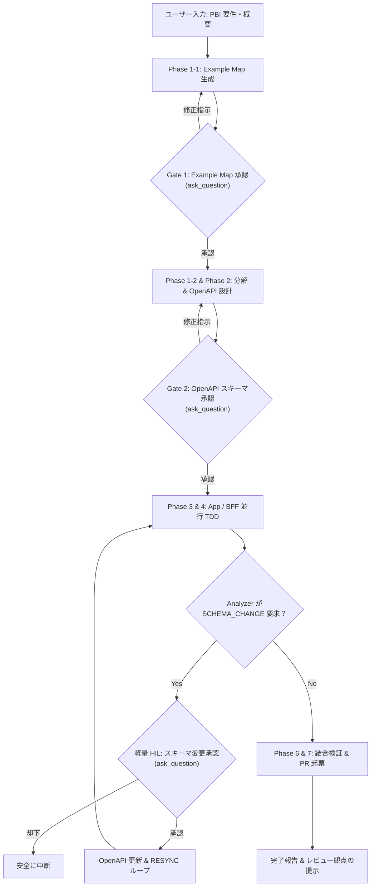

# Interactive Workflow Runner (Antigravity Chat Conductor)

本スキルは、ユーザーが Antigravity チャット上で **「PBI-xxx を作って」「ワークフローを開始して」** と入力した際に起動し、UI モーダル（`ask_question`）を用いて人間確認ゲートを対話的に進行させながら、最終的な GitHub PR の起票までを完全自律・伴走するプロトコルです。

---

## 1. 全体フローと人間ゲートの役割



---

## 2. 対話実行プロトコル（ステップ詳細）

### ステップ 1: PBI の受け付けと Example Map 生成 (Gate 1)

1. ユーザーからの PBI ID および要件テキストを受け取る（例: `PBI-101 ユーザー登録機能`）。
2. `orchestrator.interactive.run_single_step` または python スクリプトを用いて Phase 1-1 を実行：
   ```bash
   python -c "import asyncio; from orchestrator.interactive import run_single_step; asyncio.run(run_single_step('example_map', 'PBI-101', 'PBI概要テキスト'))"
   ```
3. 生成された `specs/example-maps/{pbi_id}.md` を読み取り、**ルール（BIZ-xxx）、具体例、確認事項** をチャット上に簡潔に要約して提示する。
4. **`ask_question` ツールを呼び出してインタラクティブ承認モーダルを表示する**：
   - **Question**: `【Gate 1: Example Map 確認・承認】specs/example-maps/{pbi_id}.md を生成しました。ルールと具体例、確認事項を確認してください。この内容で承認して Phase 2 (OpenAPI 設計) に進みますか？`
   - **Options**:
     - `(Recommended) 承認して Phase 2 (OpenAPI Draft) へ進む`
     - `修正を指示する（ルールや具体例の追記・変更）`
     - `パイプラインを中断する`
5. ユーザーが修正指示（Feedback）を入力した場合は、フィードバックを渡して再生成ループを回す。

---

### ステップ 2: OpenAPI 仕様生成とスキーマ承認 (Gate 2)

1. Gate 1 承認後、分解（`decompose`）とスキーマドラフト（`draft_schema`）を実行：
   ```bash
   python -c "import asyncio; from orchestrator.interactive import run_single_step; asyncio.run(run_single_step('decompose', 'PBI-101')); asyncio.run(run_single_step('draft_schema', 'PBI-101'))"
   ```
2. 生成された `specs/api/v1/{pbi_id}.yaml` を読み取り、エンドポイント（Method / Path）、リクエスト・レスポンスモデルの要約を提示する。
3. **`ask_question` ツールを呼び出してインタラクティブ承認モーダルを表示する**：
   - **Question**: `【Gate 2: OpenAPI スキーマ確認・承認】specs/api/v1/{pbi_id}.yaml を作成しました。API エンドポイントおよびデータ型を確認してください。このスキーマで承認して Phase 3/4 (並行 TDD 開発) に進みますか？`
   - **Options**:
     - `(Recommended) 承認して Phase 3/4 (App / BFF 並行 TDD) へ進む`
     - `修正を指示する（エンドポイント・パラメータの変更）`
     - `パイプラインを中断する`
4. ユーザーが修正指示を入力した場合は、フィードバックを反映してスキーマを再生成する。

---

### ステップ 3: タスク初期化 & App / BFF 並行開発 (Phase 3 & 4)

1. モックサーバー（Prism）契約とタスク状態を初期化（`initialize_tasks`）。
2. App と BFF のコンポーネントパイプラインを並行実行する（Inner TDD + Outer BDD Loop + Analyzer 自律修復）。
3. **Analyzer から `SCHEMA_CHANGE_REQUESTED` が返された場合 (軽量 HIL)**：
   - Analyzer の Directive、変更指示、変更理由を提示する。
   - **`ask_question` ツールを呼び出してモーダルを表示する**：
     - **Question**: `【Lightweight HIL: スキーマ変更 (RESYNC) の確認】Analyzer が実装中に以下のスキーマ変更を提案しました。\n\n指示: {instruction}\n理由: {reason}\n\nこの変更を承認し、自動 RESYNC を実行しますか？`
     - **Options**:
       - `(Recommended) スキーマ変更を承認し RESYNC を実行する`
       - `スキーマ変更を却下する（実装側で回避）`
   - **承認時**: スキーマとモックを再生成し、両パイプラインに `RESYNC` Directive を配信して再同期。
   - **却下時**: パイプラインを安全に中断。

---

### ステップ 4: 結合検証 & GitHub PR 起票 (Phase 6 & 7)

1. App と BFF が両方 Green になったら、結合検証（`integration_and_pr`）を実行する。
   - 契約適合性テストおよびビジネス Gherkin BDD 結合テストを実行。
   - すべて Green の場合、GitHub PR を自動起票する。
2. **完了報告**:
   - 起票された PR URL へのリンクを提示する。
   - 実装サマリーおよびテスト実行結果を表示する。
   - **★ 人間に特にここをレビューしてほしいって箇所（Reviewer Focus Points）** を 3 点明記してチャット上でユーザーに伝える。
