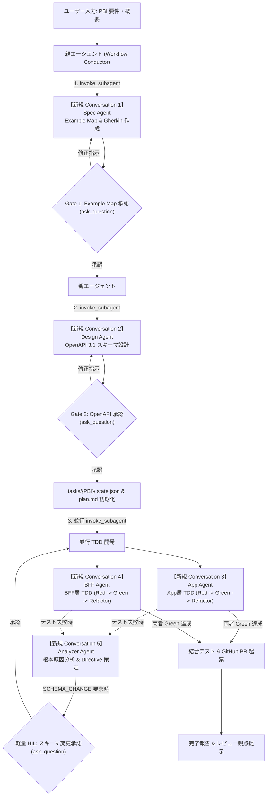

# Interactive Workflow Runner (Agent-Native Multi-Conversation Conductor)

本スキルは、ユーザーが Antigravity チャット上で **「PBI-xxx を作って」「ワークフローを開始して」** と入力した際に起動するオーケストレータープロトコルです。
各工程（仕様策定、API設計、App実装、BFF実装、エラー分析）ごとに **`invoke_subagent` を用いて独立した新規 Conversation（サブエージェント）を立ち上げ**、UI 上で並行実行・可視化しながら、対話モーダル（`ask_question`）を用いて人間確認ゲートを進行させます。

---

## 1. 全体アーキテクチャ & マルチ Conversation フロー



---

## 2. 対話実行プロトコル（ステップ詳細）

### ステップ 1: PBI の受け付けと Spec Agent の起動 (Gate 1)

1. ユーザーからの PBI ID および要件テキストを受け取る（例: `PBI-101 ユーザー登録機能`）。
2. **`invoke_subagent` を呼び出して Spec Agent を【新規 Conversation】として起動する**：
   - `TypeName`: `"self"`
   - `Role`: `"Spec Agent ({pbi_id})"`
   - `Prompt`:
     ```text
     あなたは Spec Agent です。.agents/definitions/spec_agent.md の定義に従い、以下のPBI要件から Example Map と Gherkin シナリオを作成してください。

     # PBI ID: {pbi_id}
     # 要件概要: {pbi_content}

     作成対象ファイル:
     - specs/example-maps/{pbi_id}.md
     - specs/features/business/{pbi_id}.feature
     - specs/features/app/{pbi_id}.feature
     - specs/features/bff/{pbi_id}.feature

     すべてのファイルを作成し終えたら、作成完了を報告してください。
     ```
3. Spec Agent の完了通知を受信したら、生成された `specs/example-maps/{pbi_id}.md` を読み取り、**ルール（BIZ-xxx）、具体例、確認事項** をチャット上に要約して提示する。
4. **`ask_question` ツールを呼び出してインタラクティブ承認モーダルを表示する**：
   - **Question**: `【Gate 1: Example Map 確認・承認】specs/example-maps/{pbi_id}.md を生成しました。ルールと具体例、確認事項を確認してください。この内容で承認して Phase 2 (OpenAPI 設計) に進みますか？`
   - **Options**:
     - `(Recommended) 承認して Phase 2 (OpenAPI Draft) へ進む`
     - `修正を指示する（ルールや具体例の追記・変更）`
     - `パイプラインを中断する`
5. ユーザーが修正指示（Feedback）を入力した場合は、Spec Agent に指示を再送して更新させる。

---

### ステップ 2: OpenAPI 仕様生成とスキーマ承認 (Gate 2)

1. Gate 1 承認後、**`invoke_subagent` を呼び出して Design Agent を【新規 Conversation】として起動する**：
   - `TypeName`: `"self"`
   - `Role`: `"Design Agent ({pbi_id})"`
   - `Prompt`:
     ```text
     あなたは Design Agent です。.agents/definitions/design_agent.md の定義に従い、作成された仕様書（specs/features/bff/{pbi_id}.feature および specs/example-maps/{pbi_id}.md）をもとに OpenAPI 3.1.0 スキーマを作成してください。

     作成対象ファイル: specs/api/v1/{pbi_id}.yaml

     作成完了後、エンドポイント一覧とスキーマ概要を報告してください。
     ```
2. Design Agent の完了後、`specs/api/v1/{pbi_id}.yaml` を読み取り、エンドポイント（Method / Path）およびリクエスト・レスポンスモデルの要約を提示する。
3. **`ask_question` ツールを呼び出してインタラクティブ承認モーダルを表示する**：
   - **Question**: `【Gate 2: OpenAPI スキーマ確認・承認】specs/api/v1/{pbi_id}.yaml を作成しました。API エンドポイントおよびデータ型を確認してください。このスキーマで承認して Phase 3/4 (並行 TDD 開発) に進みますか？`
   - **Options**:
     - `(Recommended) 承認して Phase 3/4 (App / BFF 並行 TDD) へ進む`
     - `修正を指示する（エンドポイント・パラメータの変更）`
     - `パイプラインを中断する`
4. 修正指示がある場合は Design Agent に再送してスキーマを更新させる。

---

### ステップ 3: タスク初期化 & App / BFF 並行開発 (Phase 3 & 4)

1. **タスク状態の初期化**:
   - `tasks/{pbi_id}/state.json` がある場合は現在の state と plan を読み、既存の作業を再開する。`init_pbi` で既存状態を上書きしない。
   - 未初期化の場合のみ `python -c "from orchestrator.state_manager import StateManager; StateManager().init_pbi('{pbi_id}')"` を実行して state と component plan を作成する。
   - リセットはユーザーから明示的に依頼された場合のみ `python orchestrator/cli.py reset '{pbi_id}'` で行う。この操作は state と plan を初期化し、audit、仕様、実装ファイルは保持する。
2. **`invoke_subagent` で App Agent と BFF Agent を【2つの新規 Conversation】として並行起動する**：
   ```json
   [
     {
       "TypeName": "self",
       "Role": "App Agent ({pbi_id})",
       "Prompt": "あなたは App Agent です。.agents/definitions/app_agent.md の指示および tasks/{pbi_id}/app/plan.md に従い、App層のドメインロジック実装とテストを厳格な TDD サイクル（Red: テスト作成 & pytest src/app/tests/ 失敗確認 -> Green: 実装 & テスト成功 -> Refactor）で自律完遂してください。"
     },
     {
       "TypeName": "self",
       "Role": "BFF Agent ({pbi_id})",
       "Prompt": "あなたは BFF Agent です。.agents/definitions/bff_agent.md の指示および tasks/{pbi_id}/bff/plan.md に従い、BFF層のAPI実装とテストを厳格な TDD サイクル（Red: テスト作成 & pytest src/bff/tests/ 失敗確認 -> Green: 実装 & テスト成功 -> Refactor）で自律完遂してください。"
     }
   ]
   ```
3. **エージェントからのエラー報告・テスト失敗時**:
   - 必要に応じて `Analyzer Agent ({pbi_id})` を新規 Conversation で起動し、テスト失敗ログから原因分析を行う。
   - **Analyzer が `SCHEMA_CHANGE` を要求した場合 (軽量 HIL)**:
     - **`ask_question` ツールで確認モーダルを表示**:
       - **Question**: `【Lightweight HIL: スキーマ変更の確認】Analyzer が実装中に以下のスキーマ変更を提案しました。\n\n指示: {instruction}\n理由: {reason}\n\nこの変更を承認しますか？`
       - **Options**:
         - `(Recommended) スキーマ変更を承認し RESYNC を実行する`
         - `スキーマ変更を却下する（実装側で回避）`
     - 承認時は Design Agent にスキーマを更新させ、各エージェントの `plan.md` に RESYNC Directive を配信して再開。
   - 各コンポーネントの修復サイクルは最大 2 回とする。上限後も未解決なら Analyzer の結論と失敗ログをユーザーに提示し、無制限に subagent を再起動しない。

---

### ステップ 4: 結合検証 & GitHub PR 起票 (Phase 6 & 7)

1. App と BFF が両方 Green 完了したら、親エージェントが結合テストを実行する：
   ```bash
   pytest tests/
   ```
2. すべて Green の場合、PR サマリーファイル（`tasks/{pbi_id}/PR_SUMMARY.md`）を作成し、Git ブランチの作成・コミット・プッシュ・GitHub PR を起票する。
3. **完了報告**:
   - 起票された PR 情報（またはブランチ名）を提示。
   - 実装サマリーおよびテスト実行結果を表示。
   - **★ 人間に特にここをレビューしてほしい箇所（Reviewer Focus Points）** を 3 点明記してチャット上でユーザーに伝える。
