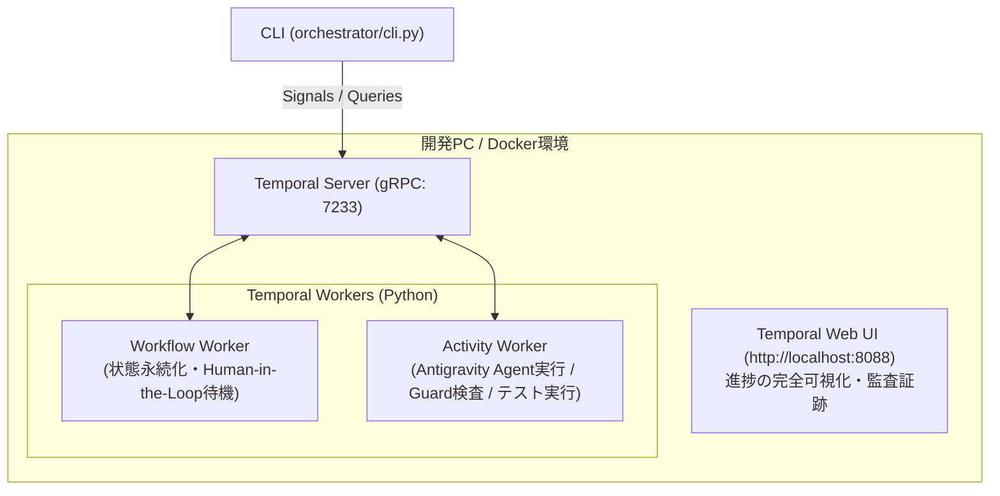

# AI-Driven Autonomous Development Project (v3.0)
〜 Example Mapping × BDD × DDD × TDD によるマルチエージェント協調開発パイプライン 〜

Temporal をオーケストレーターとし、Google Antigravity / Claude Code のエージェント能力を最大限に活かした自律開発基盤です。

---

## 1. アーキテクチャ概要



### コア機能
1. **Durable Execution（クラッシュ耐性）**: PCスリープやプロセス停止があっても直前の状態から復帰可能。
2. **人間ゲート（Human-in-the-Loop）**:
   - **ゲート 1 (Example Map)**: 要件・具体例・確認事項の合意
   - **ゲート 2 (OpenAPI Schema)**: API 契約の合意
   - **ゲート 3 (PR)**: 最終レビュー
3. **Guard による機械的強制**: `.agents/hooks.json` と `orchestrator/guards/tdd_isolation.py` による Red/Green 権限分離。

---

## 2. ディレクトリ構成

```text
.
├── docs/
│   ├── WORKFLOW.md           # ワークフロー詳細仕様書 (v3.0)
│   └── ROADMAP.md            # 段階的導入ロードマップ (P0〜P3)
├── docker-compose.yml        # Temporal Server & Web UI
├── requirements.txt          # Python 依存関係
├── .agents/
│   ├── AGENTS.md             # Antigravity 向けエージェント規約
│   ├── hooks.json            # TDD 権限分離 PreToolUse hook
│   └── rules/
│       └── gherkin-style.md  # Gherkin 規約
├── orchestrator/
│   ├── workflow.py           # Temporal ワークフロー定義
│   ├── activities.py         # 各フェーズの Activity 実装
│   ├── run_worker.py         # Worker 起動スクリプト
│   ├── cli.py                # PBI 開始・人間承認 CLI
│   └── guards/
│       └── tdd_isolation.py  # Red/Green 判定スクリプト
├── specs/                    # 仕様成果物
│   ├── example-maps/         # 人間ゲート 1 成果物
│   ├── features/             # Gherkin (business / app / bff)
│   └── api/v1/               # OpenAPI スキーマ (人間ゲート 2)
└── tasks/                    # 実行時タスク管理
```

---

## 3. クイックスタート

### ステップ 1: Temporal サーバーの起動 (Docker)
```bash
docker compose up -d
```
起動後、ブラウザで [http://localhost:8088](http://localhost:8088) にアクセスすると Temporal Web UI が確認できます。

### ステップ 2: 依存関係のインストール & Worker 起動
```bash
pip install -r requirements.txt
python -m orchestrator.run_worker
```

### ステップ 3: ワークフローの実行と人間承認 (別ターミナル)
```bash
# 1. PBI 開発ワークフローを開始
python orchestrator/cli.py start PBI-101 --description "ユーザー新規登録機能"

# 2. 進捗と人間承認待ちステータスを確認
python orchestrator/cli.py status dev-workflow-PBI-101

# 3. 生成された specs/example-maps/PBI-101.md を確認後、ゲート1を承認
python orchestrator/cli.py approve-example-map dev-workflow-PBI-101

# 4. 生成された specs/api/v1/PBI-101.yaml を確認後、ゲート2を承認
python orchestrator/cli.py approve-schema dev-workflow-PBI-101
```
承認後、App / BFF の並行自律開発パイプラインが実行され、PR サマリーが生成されます。
