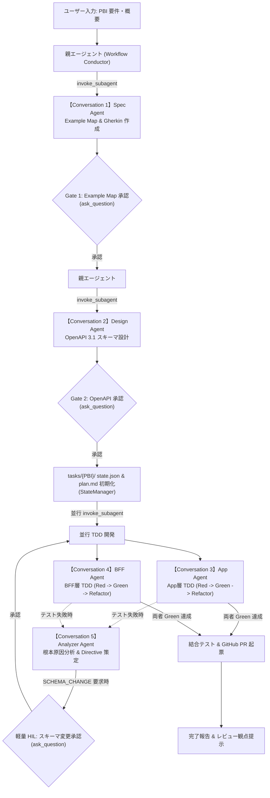

# AI-Driven Autonomous Development Project (v4.0 Agent-Native)
〜 Example Mapping × BDD × DDD × TDD によるマルチエージェント協調開発パイプライン 〜

外部デーモン（Temporal 等）を完全撤廃し、**ファイル駆動型プロトコル（File-Driven Protocol）** と **Antigravity Subagent（独立 Conversation 並行協調）** によって動作する自律開発基盤です。

---

## 1. アーキテクチャ概要



### コア機能
1. **外部デーモン不要（Agent-Native）**: Temporal や Docker を必要とせず、pure Python と OS ネイティブ排他ロック（msvcrt / fcntl）付きの `state_manager.py` で完結。
2. **独立 Conversation (Subagent) 協調**: `invoke_subagent` により各フェーズが独立した会話タブで立ち上がり、コンテキスト汚染を防止しながら並行自律実行。
3. **人間ゲート（Human-in-the-Loop）**:
   - **ゲート 1 (Example Map)**: 要件・具体例・確認事項の合意 (`ask_question`)
   - **ゲート 2 (OpenAPI Schema)**: API 契約の合意 (`ask_question`)
   - **軽量 HIL (SCHEMA_CHANGE)**: 実装中のスキーマ変更提案と再同期（RESYNC）
   - **ゲート 3 (PR)**: 最終レビュー
4. **TDD 物理的権限分離 Guard**: `.agents/hooks.json` と `orchestrator/guards/tdd_isolation.py` による Red/Green ファイル編集の機械的強制。

---

## 2. ディレクトリ構成

```text
.
├── docs/
│   ├── WORKFLOW.md           # ワークフロー詳細仕様書 (v4.0 Agent-Native)
│   ├── ROADMAP.md            # 段階的導入ロードマップ (P0〜P5)
│   └── PROGRESS.md           # 全体進捗とアーキテクチャ対比表
├── requirements.txt          # Python 依存関係 (外部デーモン不要)
├── .agents/
│   ├── AGENTS.md             # 自律エージェント運用ポリシー
│   ├── definitions/          # 各ロール定義 (spec, design, app, bff, analyzer)
│   ├── hooks.json            # TDD 権限分離 PreToolUse hook
│   ├── skills/               # workflow-runner, analyzer, pr-review
│   └── rules/                # Gherkin 規約
├── orchestrator/
│   ├── state_manager.py      # ファイル駆動型状態管理 (OS排他ロック付き)
│   ├── interactive.py        # 対話実行エンジン
│   ├── cli.py                # ターミナル対話 & 状態管理 CLI
│   └── guards/
│       ├── tdd_isolation.py  # Red/Green 物理的保護スクリプト
│       ├── analyzer.py       # 5ルート根本原因分析エンジン
│       └── rule_guard.py     # pytest ログ機械的分類
├── specs/                    # 仕様成果物
│   ├── example-maps/         # 人間ゲート 1 成果物
│   ├── features/             # Gherkin (business / app / bff)
│   └── api/v1/               # OpenAPI スキーマ (人間ゲート 2)
└── tasks/                    # 実行時タスク管理 (Single Source of Truth)
    └── {PBI-ID}/
        ├── state.json        # 正となる状態 (排他制御)
        ├── app/plan.md       # App Agent ビュー & Directive
        ├── bff/plan.md       # BFF Agent ビュー & Directive
        └── audit.jsonl       # 監査ログ (追記専用)
```

---

## 3. クイックスタート

### ステップ 1: 依存関係のインストール
```bash
pip install -r requirements.txt
```

### ステップ 2: 開発ワークフローの実行

#### 方法 A: Antigravity チャット UI から起動（推奨）
Antigravity チャット上で以下のように入力するだけで、対話モーダル（`ask_question`）と独立サブエージェント（新規 Conversation）が立ち上がり、自律開発パイプラインが進行します：
```text
PBI-101 ユーザー新規登録機能を作って
```

#### 方法 B: タスク状態の手動管理・確認
```bash
# タスクの初期化 (tasks/PBI-101/ 配下を作成)
python orchestrator/cli.py init PBI-101

# 進捗ステータスの確認
python orchestrator/cli.py status PBI-101

# Directive (指示) の配信
python orchestrator/cli.py directive PBI-101 app FIX_TEST -r "アサーション誤り" -i "ステータスコードを400に修正"

# state.json と plan.md のみを明示的にリセット (audit/spec/実装は保持)
python orchestrator/cli.py reset PBI-101
```

自動開発ワークフローは Antigravity チャットから `workflow-runner` スキルを使って起動してください。CLI はタスク状態の管理専用です。旧 `orchestrator.interactive` / `orchestrator.activities` は互換性と既存テストのため残していますが、v4.0 では非推奨で、Gemini ベースの旧実行経路です。
