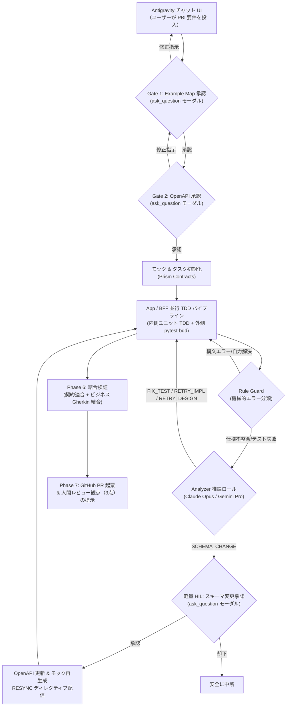

# AI-Driven Autonomous Development Workflow: 開発進捗と残タスク

本書は、自律開発ワークフロー基盤の実装成果（PR #1〜PR #11）と、Antigravity チャット UI を起点とした実運用へ向けた引き継ぎ・進捗共有ドキュメントです。

---

## 1. 全体到達状況サマリー

ロードマップ（[`docs/ROADMAP.md`](ROADMAP.md)）に基づき、**P0（基盤整備）、P1（直列自律パイプライン）、P2（並行化 & スキーマ同期）、および P4（Agent-Native マルチConversation移行）は 100% 完了** しました。

* **テスト合格率**: **全 95 件 100% パス** (`pytest`)
* **静的解析・型チェック**: **エラー 0 件** (`ruff check`, `ruff format --check`, `mypy .`)
* **マージ済み PR**: **全 11 件** (PR #1 〜 PR #11)
* **外部依存**: **Temporal デーモン不要、Gemini API キー不要（Antigravity セッションで完結）**

```
[P0: 基盤整備] ──────────── 100% (PR #1, #2, #3, #7)
[P1: 直列自律TDD] ───────── 100% (PR #4, #5, #6, #8, #9)
[P2: 並行化 & RESYNC] ───── 100% (PR #8, #9, #10)
[P4: Agent-Native化] ────── 100% (PR #11)
[P5: Claude/Codex連携] ──── 準備完了（プロトコル共通化済み）
[P3: 最適化 & KPI] ──────── 条件付き（必要に応じて追加）
```

---

## 2. マージ済み PR と実装成果一覧

| PR | タイトル | 担当領域 | 主な実装成果 |
| :---: | :--- | :---: | :--- |
| **#1** | 初期 CI 環境と基盤構築 | P0-1 | GitHub Actions、基本ディレクトリ構造、テスト自動実行環境 |
| **#2** | ルール・設計規約の整備 | P0-2 | Gherkin スタイルガイド、DDD 設計規約、権限分離ルール |
| **#3** | 仕様具体化と手動ドライラン | P0-3/4 | Example Mapping → Gherkin 仕様分解、初期 PBI ドライラン検証 |
| **#4** | オーケストレーター最小版 | P1-1 | [Deprecated in v4.0] Temporal ワークフロー基盤、耐久ステートマシン |
| **#5** | TDD 権限分離 & Rule Guard | P1-2/3 | Red/Green/Refactor の物理的ファイル保護、pytest ログ機械的分類 |
| **#6** | 結合検証 & PR 自動起票 | P1-6 | Integration Gate（契約検証 + Gherkin 結合）、GitHub PR 自動作成 |
| **#7** | 品質・型チェックベースライン | P0-1 | `ruff` (Lint & Format) + `mypy` 完全導入（CI 強制） |
| **#8** | Analyzer ディレクティブエンジン | P1-4 | 5 ルート自律自己修復ループ（`FIX_TEST`, `RETRY_IMPL`, `RETRY_DESIGN`, `SCHEMA_CHANGE`, `ESCALATE_HUMAN`） |
| **#9** | 受け入れテスト外側ループ | P1-5 | `pytest-bdd` による二重ループ TDD 実装（仕様適合の機械的保証） |
| **#10**| P2-5 スキーマ変更同期 & 対話型 Runner | P2-5 | スキーマ変更検知 → 軽量 HIL → スキーマ/モック再生成 → `RESYNC` 再同期ループ、対話スキル |
| **#11**| **v4.0 Agent-Native マルチConversation移行** | **P4** | **Temporal 依存撤廃、Gemini API 直接呼出撤廃、`.agents/definitions/` 独立化、`state_manager.py` 導入、新規 Conversation 協調パイプライン確立** |

---

## 3. 実現済みの主要アーキテクチャ

### 3-0. アーキテクチャ進化の対比 (v3.0 Deprecated vs v4.0 Current)

| 観点 | 旧仕様 (v3.0 Deprecated) | 現行仕様 (v4.0 Agent-Native) | 進化の理由・メリット |
| :--- | :--- | :--- | :--- |
| **オーケストレーション** | **Temporal Server**<br>（Docker / DB / 常駐 Worker） | **ファイル駆動型 StateManager**<br>（OS 排他ロック付き `state.json`） | Temporal の重い管理コスト・常駐デーモンを完全撤廃。Antigravity 内で即座に完結。 |
| **LLM 呼び出し** | **Gemini API 直接呼出**<br>（`google.genai` SDK） | **Antigravity Subagent**<br>（`invoke_subagent`） | API キー設定・課金管理不要。単なるテキスト補完からツール自律実行エージェントへ進化。 |
| **実行コンテキスト** | 単一スクリプト内で直列・同期処理 | **マルチ Conversation 協調**<br>（独立会話タブ並行起動） | 各工程（Spec, App, BFF, Analyzer）が独立タブで立ち上がり、思考・コマンド・ログが完全に可視化。 |
| **ポータビリティ** | Temporal & Gemini API 固有の密結合 | **疎結合なファイル駆動プロトコル**<br>（`.agents/definitions/` + `plan.md`） | 将来 **Claude Code CLI** や **Codex** に切り替える際も同一仕様ファイルで動作可能。 |

### 3-1. 自律開発パイプラインの全体フロー (v4.0)



### 3-2. 実装されたコアモジュール

1. **ファイル駆動状態管理 & エージェント定義**:
   - [`orchestrator/state_manager.py`](../orchestrator/state_manager.py): OS ネイティブ排他ロック（Windows msvcrt / POSIX fcntl）を備えた軽量な `tasks/{PBI}/state.json` 管理。
   - [`.agents/definitions/`](../.agents/definitions/): `spec_agent.md`, `design_agent.md`, `app_agent.md`, `bff_agent.md`, `analyzer_agent.md`。Claude Code / Codex でも再利用可能な標準 Markdown 定義。
2. **二重ループ TDD & 仕様分解**:
   - [`orchestrator/activities.py`](../orchestrator/activities.py): `decompose_specs_activity`, `draft_schema_activity`, `run_tdd_cycle_activity`
   - Business Gherkin から App / BFF への責務分解と `@covers` タグによるトレーサビリティ保証。
   - `pytest-bdd` による外側受け入れテストループ（Step definition 自動バインド）。
3. **Rule Guard & Analyzer 5 ルート自己修復**:
   - [`orchestrator/guards/rule_guard.py`](../orchestrator/guards/rule_guard.py): pytest 出力を 6 カテゴリに機械的分類。
   - [`orchestrator/guards/analyzer.py`](../orchestrator/guards/analyzer.py): テスト自体の誤りを是正する `FIX_TEST`、実装方針を示す `RETRY_IMPL`、再設計を促す `RETRY_DESIGN`、契約不整合を解消する `SCHEMA_CHANGE`、エスカレーション `ESCALATE_HUMAN` を判定。
4. **対話型 Antigravity マルチ Conversation 実行環境**:
   - [`.agents/skills/workflow-runner/SKILL.md`](../.agents/skills/workflow-runner/SKILL.md): `invoke_subagent` でフェーズごとに新規 Conversation を立ち上げ、`ask_question` モーダルで Gate 1 / Gate 2 / 軽量 HIL を進行するオーケストレーター。
   - *（注: 旧 Temporal 関連コードは完全削除され、純粋な Python + StateManager による実行へ一本化されました）*

---

## 4. Antigravity チャット UI 経由での利用方法

Antigravity チャットで PBI 開発を開始する手順：

1. **チャットで開始指示を入力**:
   ```text
   PBI-101 ユーザー登録およびバリデーション機能 を作って！
   ```
2. **Gate 1 (Example Map 承認)**:
   - Antigravity が `specs/example-maps/PBI-101.md` を生成。
   - 画面上に承認モーダル（`ask_question`）がポップアップ。
   - `[✔ (Recommended) 承認して Phase 2 へ進む]` または `[修正指示を入力]` を選択。
3. **Gate 2 (OpenAPI スキーマ承認)**:
   - Antigravity が `specs/api/v1/PBI-101.yaml` を生成。
   - エンドポイント・モデルの承認モーダルが表示され、承認をクリック。
4. **Phase 3/4 並行開発 & 軽量 HIL**:
   - App と BFF が並行して TDD 実装を自律進行。
   - Analyzer からスキーマ変更要求があった場合、軽量 HIL モーダルが表示され、ワンクリックで承認（RESYNC）可能。
5. **Phase 6/7 結合検証 & PR 起票**:
   - 結合テストが完了し、GitHub PR が起票される。
   - **「人間に特にここをレビューしてほしい箇所（3点）」** と共に完了報告が表示される。

---

## 5. 残りの作業（Next Actions）

### ① 【直近の最優先】Antigravity 対話型 UI 経由での実 PBI 開発 E2E ドライラン
* **目的**: 
  P2 の完了判定条件である **「App と BFF にまたがる PBI 3件以上が、並行実行で PR まで到達する」** を実証する。
* **タスク**:
  1. 実際の業務に近いシナリオ（例: `PBI-101 ユーザー情報取得`, `PBI-102 カート商品追加`, `PBI-103 決済処理`）を順次 Antigravity チャットに投入。
  2. チャット上の `ask_question` モーダル応答だけで PR まで完走できるか、操作性と自律修復精度を検証。
  3. 各 PBI 実行時のトークン消費量・完了時間・Analyzer 介入履歴を記録。

### ② P2-6 結合検証の差し戻しループ微調整
* **目的**: 
  Phase 6 結合テストでエラーが発生した際、Analyzer が「App 側の実装不備」か「BFF 側のマッピング不備」かを特定し、対象パイプラインへピンポイントに差し戻すディレクティブ連携を精緻化する。

### ③ P3 最適化（実運用データ・KPI に応じて条件付き導入）
ロードマップに基づき、トリガー条件を満たした施策のみ順次導入：
* **意味的カバレッジ検査**: `@covers` は満たしているが、仕様漏れが発生する場合に LLM 照合を追加。
* **KPI ダッシュボード**: `audit.jsonl` を集計し、自律修復成功率やリードタイム推移を可視化。

---

## 6. 主要ファイルリファレンス

* **ロードマップ**: [`docs/ROADMAP.md`](ROADMAP.md)
* **詳細仕様書**: [`docs/WORKFLOW.md`](WORKFLOW.md)
* **状態管理 (SSOT)**: [`orchestrator/state_manager.py`](../orchestrator/state_manager.py)
* **対話型ランナー**: [`orchestrator/interactive.py`](../orchestrator/interactive.py)
* **CLI インターフェース**: [`orchestrator/cli.py`](../orchestrator/cli.py)
* **Analyzer エンジン**: [`orchestrator/guards/analyzer.py`](../orchestrator/guards/analyzer.py)
* **Rule Guard**: [`orchestrator/guards/rule_guard.py`](../orchestrator/guards/rule_guard.py)
* **Antigravity スキル**: [`.agents/skills/workflow-runner/SKILL.md`](../.agents/skills/workflow-runner/SKILL.md)
