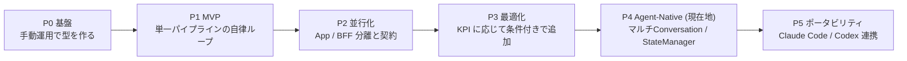

# 導入ロードマップ

[WORKFLOW.md](./WORKFLOW.md)（v4.0 Agent-Native）を段階的に導入・発展させるための手順書です。

> [!IMPORTANT]
> **基本方針**: 一度に全部を入れない。各ステージの **完了条件** を満たしてから次へ進む。
> 層を追加するたびに、うまくいかなかったときの原因の切り分けが難しくなるためです。

---

## 全体像

| 優先度 | ステージ | 目的 | 状態 |
| :--- | :--- | :--- | :--- |
| **P0** | 基盤 | 人間ゲートと品質の土台を作る。自律化はまだしない | ✅ 完了 |
| **P1** | MVP | 1つの層・1つのエージェントで、PBI → PR の自律ループを成立させる | ✅ 完了 |
| **P2** | 並行化 | App / BFF を契約で分離し、並行して開発する（RESYNC 同期対応） | ✅ 完了 |
| **P3** | 最適化 | KPI を見て、必要な層だけを追加する | 継続的 |
| **P4** | **エージェントネイティブ** | **【v4.0 現在地】Temporal / API 直接呼出を撤廃し、Subagent（新規 Conversation）協調へ** | ✅ 完了 |
| **P5** | **エージェントポータビリティ** | **Claude Code CLI や Codex から同一プロトコルで駆動** | 準備完了 |

---

## P0: 基盤（自律化の前提）

> 自律ループを回す前に、ループが判定に使う材料（CI・ルール・要件）を揃えるステージです。

### P0-1. CI ベースライン & ブランチ保護
* **手順**
  1. Lint・フォーマット・型チェック・テスト・ビルドを CI で必須にする
  2. main へのマージに CI 成功と人間の承認を必須にする
  3. エラー出力をパースしやすい形式にそろえる（`--format json` など。Rule Guard の下準備）
* **なぜ必要か**: 自律ループの合否判定はすべて CI の結果に依存します。CI が不安定だったり抜け穴があったりすると、エージェントは誤った成功・失敗に向かって最適化してしまいます。
* **完了条件**: CI が安定してグリーン（flaky テストが 0）。保護を通らずにマージできない

### P0-2. Rules の整備
* **手順**
  1. `AGENTS.md`（Antigravity は `GEMINI.md` も、Claude Code は `CLAUDE.md`）にアーキテクチャ・命名・ディレクトリ規約を書く
  2. `gherkin-style` ルールを作る（宣言的・日本語・ルール単位でタグ付け）
  3. 両ツールで同じ内容を参照できるようにする（片方を正本にしてもう片方から参照する）
* **なぜ必要か**: エージェントの出力のばらつきは、ほとんどが前提知識の不足から来ます。規約が書かれていないと、Analyzer の Directive も毎回同じ指摘の繰り返しになります。
* **完了条件**: 新しいセッションのエージェントに小さなタスクを渡し、規約に沿ったコードが出てくる

### P0-3. Example Mapping → Gherkin（人間ゲート 1）
* **手順**
  1. `example-mapping` Skill を作る（確認事項を洗い出す観点：境界値・権限・状態・並行性・削除時の扱い）
  2. Example Map のテンプレートを作る（`specs/example-maps/{PBI-ID}.md`）
  3. 実際の PBI 2〜3件で、Gemini 3.8 Flash (High) に Example Map を作らせ、PO が確認事項に回答する
  4. Example Map からビジネス Gherkin を生成し、整合チェックのプロンプトを調整する
* **なぜ必要か**: 要件の品質がパイプライン全体の上限を決めます。後工程をどれだけ自動化しても、ここが曖昧なら最後のフル HIL に戻ってくるだけです。また、PO にとって負担の少ないレビューの形を最初に固めておく必要があります。
* **完了条件**: PO が「これなら毎回レビューできる」と言える。AI の確認事項に、PO が気づいていなかった論点が含まれている

### P0-4. 手動ドライラン（人間がオーケストレーターを兼ねる）
* **手順**
  1. P0-3 の PBI 1件を、[WORKFLOW.md](./WORKFLOW.md) の手順どおりに **人間がフェーズを切り替えながら** エージェントに実行させる
  2. 詰まった箇所、手戻りの原因、各フェーズのトークン数を `audit.jsonl` に手で記録する
* **なぜ必要か**: 自動化する前に、どこで詰まるのかを実際に見るためです。P1 で作るオーケストレーターの状態遷移・カウンタ上限・Analyzer の振り分け基準は、このときの記録をもとに決めます。
* **完了条件**: 1 PBI を PR まで通し、詰まりポイントのリストができている

---

## P1: MVP（単一パイプラインの自律ループ）

> **対象は1つの層だけ**（BFF を推奨。UI テストより結果が決定的で、スキーマ検証も使えるため）。
> 小さめの PBI を選ぶ。

### P1-1. オーケストレーター最小版
> [!NOTE]
> **【Deprecated in v4.0】Temporal から軽量 StateManager への移行**:
> 当初は Temporal Server による耐久ワークフロー（`workflow.py`）として構築されましたが、Temporal デーモン・Worker の常駐や管理コストが重かったため、v4.0 では `orchestrator/state_manager.py` による軽量なファイル駆動型（OS 排他ロック付き `state.json`）へ移行しました。
* **手順**
  1. `state.json` によるフェーズ遷移（DESIGN → RED → GREEN → REFACTOR → VERIFY → DONE）を実装する
  2. カウンタ（`rule_guard` / `self_retry` / `analyzer_cycles`）とトークン予算を実装し、上限を超えたら停止して通知する
  3. `plan.md` のフロントマターと進捗欄を `state.json` から生成する
  4. エージェントは headless モードで呼び出す（Claude Code なら `claude -p`、Antigravity なら CLI / Subagents）
* **なぜ必要か**: リトライ回数やフェーズを LLM に管理させると、書き忘れ・書き間違い・リセットが起きます。サーキットブレーカーはそれ自体が壊れない場所に置く必要があります。後続の Guard もすべて `state.json` のフェーズを参照します。
* **完了条件**: 意図的に失敗するタスクを入れたとき、上限で確実に止まり通知が届く

### P1-2. TDD 権限分離 Guard
* **手順**
  1. PreToolUse hook で、ファイル編集ツールをフェーズとパスに応じて `deny` にする（`.agents/hooks.json` / `.claude/settings.json`）
  2. フェーズ終了時に、オーケストレーターが `git diff --name-only` で書き込み禁止パスへの変更を検査する（シェル経由の書き込み対策）
  3. Red 検証を実装する：新規テストがアサーションで失敗し、既存テストは通ること
* **なぜ必要か**: 通らないテストをゆるめて Green に見せかけるのは、自律 TDD で最も起きやすく、最も見つけにくい不正です。Skill で「テストを変えるな」と書いてもモデルは破ることがあるので、物理的に止めます。hook だけではシェル経由の書き込みをすり抜けられるため、diff 検査と二重にします。
* **完了条件**: Green フェーズでテストを編集させようとすると、hook と diff 検査のどちらでも止まる

### P1-3. Rule Guard スクリプト
* **手順**
  1. CI の出力（P0-1 で整形済み）を分類するスクリプトを作る：構文 / 型 / Lint / テスト失敗 / その他
  2. 構文・型・Lint はエラー全文を添えて Implementer に戻す。テスト失敗は自己リトライに回す
* **なぜ必要か**: 機械的に判定できるエラーに LLM を使うのは、コストと時間の無駄です。また、分類ができていないと Analyzer に渡すべき問題が見分けられません。
* **完了条件**: P0-4 で記録した失敗パターンの大半を、LLM なしで正しく振り分けられる

### P1-4. Analyzer（Claude Opus 5.5 High）
* **手順**
  1. `analyzer` Skill を作る：入力（失敗ログ・関連コード・spec・plan・直近の audit）、5つの振り分け先（`RETRY_DESIGN` / `RETRY_IMPL` / `FIX_TEST` / `SCHEMA_CHANGE` / `ESCALATE_HUMAN`）、Directive のフォーマット
  2. 書き込み権限は与えない。出力するのは Directive だけで、オーケストレーターが `plan.md` と audit に反映する
  3. **`FIX_TEST` ルートを必ず入れる**
* **なぜ必要か**: Implementer（Flash Medium）が自力で抜け出せない問題を、強いモデルで分析する層です。Jev を置かずに Analyzer 1層で済ませるので、高価なモデルを呼ぶのは本当に詰まったときだけになります。`FIX_TEST` がないと、テスト自体が誤っているときに上限まで空回りします。
* **完了条件**: Analyzer の Directive で、詰まったタスクの過半数が解決する。振り分けの誤りを人間が見て許容できる

### P1-5. 受け入れテストの実行（外側ループ）
* **手順**
  1. Gherkin ランナーを導入する（Cucumber.js / playwright-bdd など、スタックに合わせて）
  2. Red で step definition を作り、VERIFY で毎回実行する
* **なぜ必要か**: 実行されない Gherkin はただのドキュメントで、仕様とコードがずれていても誰も気づけません。ユニットテストがすべて通っても仕様を満たしていない、という状態をここで防ぎます。
* **完了条件**: Example Map の全具体例が受け入れテストとして実行され、通っている

### P1-6. PR 生成
* **手順**: 1 PBI = 1 PR。本文に Example Map へのリンク、`BIZ-ID → シナリオ → テスト → 実装` の対応表、Analyzer の介入履歴を載せる
* **なぜ必要か**: 最終レビューが人間のボトルネックになります。対応表があれば、全部読まなくても要件との対応を確認できます。
* **完了条件**: レビュアーが対応表を起点にレビューできている

### ✅ P1 の完了条件（P2 へ進む判断）
* 小さな PBI **3〜5件** が、人間ゲート以外の介入なしに PR まで到達する
* フル HIL へのエスカレーションが、要件の不備によるものだけになっている（仕組みの不備によるものが 0）
* KPI のベースライン（PBI あたりのトークン・時間、自己リトライ成功率、Analyzer 介入率）が取れている

---

## P2: 並行化（App / BFF の分離）

### P2-1. Schema First + 人間ゲート 2
* **手順**: BFF Gherkin から OpenAPI ドラフトを作り、**初版から人間が承認する**。`examples` には Example Map の具体例を使う
* **なぜ必要か**: 並行開発は契約が固まっていることが前提です。契約が揺れると、両方のパイプラインが同時に手戻りします。
* **完了条件**: スキーマが承認されるまで、実装フェーズが始まらない

### P2-2. モック生成（fixture 一元化）
* **手順**: OpenAPI からハンドラーの雛形を生成し、異常系・状態遷移のシナリオは Gherkin 由来の fixture から生成する。ハンドラーの直接編集は Guard で禁止する
* **なぜ必要か**: App 側が BFF の完成を待たずに異常系まで検証するためです。生成元を一元化しておかないと、モックが実際の仕様からずれていきます。
* **完了条件**: Example Map の異常系の具体例が、すべてモックで再現できる

### P2-3. Spec 分解 + `@covers` + 構造検査
* **手順**: `spec-decomposition` Skill と、Gherkin パーサーを使った構造検査スクリプトを作る
* **なぜ必要か**: 層を分けると、ビジネス要件のどこが誰の担当なのかが見えにくくなります。トレーサビリティが、抜け漏れを検知する唯一の手段になります。
* **完了条件**: covers されていない BIZ も、covers を持たないシナリオもない

### P2-4. 並行パイプライン
* **手順**: オーケストレーターが App / BFF を独立に起動・管理する（片方が失敗しても、もう片方は止めない）
* **なぜ必要か**: 並行化による短縮効果を得るためです。合流点を Phase 6 だけに限定することで、待ち合わせの制御を単純にしています。
* **完了条件**: 片方を意図的に失敗させても、もう片方は完了まで進む

### P2-5. スキーマ変更の同期（RESYNC） & 対話型 Antigravity Runner [完了]
* **手順**: 軽量 HIL で承認されたら、モックを再生成し、両パイプラインに RESYNC Directive を出す。Analyzer がどこから再開するかを判定する。また、Antigravity チャット UI 上で対話的にゲートを通過できる Runner を提供する。
* **なぜ必要か**: 片方の都合でスキーマが変わると、もう片方が古い前提のまま作業を続け、結合段階で大きな手戻りになります。また、人間承認ゲートをチャット UI 内でシームレスに完結させることでリードタイムを短縮します。
* **完了条件**: スキーマを変更すると影響を受けるパイプラインが自動で再同期し、Antigravity UI 上で対話的にゲートを通過できる

### P2-6. 結合検証
* **手順**: App のリクエストと BFF のレスポンスを OpenAPI で検証し、ビジネス Gherkin を結合環境で実行する。失敗したら Analyzer へ
* **なぜ必要か**: それぞれのパイプラインが通っても、組み合わせて動く保証はないためです。
* **完了条件**: 結合検証の失敗が、該当パイプラインへ自動で差し戻される

### ✅ P2 の完了条件
* App と BFF にまたがる PBI 3件以上が、並行実行で PR まで到達する
* 直列で実行した場合と比べて、リードタイムが短くなっている

---

## P3: 最適化（KPI に応じて条件付きで追加）

> **どれも、導入する条件を満たしたときだけ入れる**。条件を満たさなければ入れない。

| 施策 | 導入する条件（トリガー） | 内容 |
| :--- | :--- | :--- |
| **意味的カバレッジ検査** | `@covers` は満たしているのに、受け入れテストで仕様漏れが見つかる | ビジネス層の「ならば」の検証箇所を LLM で照合する |
| **Implementer の High 昇格** | 自己リトライ成功率が低く、Analyzer の振り分けが `RETRY_IMPL` に偏っている | 2回目の自己リトライだけ thinking を High にする |
| **設計レビュー** | Analyzer の振り分けで `RETRY_DESIGN` の割合が高い | 4-1 の後に Analyzer（Opus）が設計をレビューする |
| **Red レビュー** | `FIX_TEST` の発生率が高い | Red の後に、テストと仕様の整合を LLM でチェックする |
| **Triage 層（旧 Jev）** | Analyzer の呼び出しコストが大きく、その中に軽微な問題が多く含まれている | 軽量モデルで一次振り分けしてから Analyzer に渡す |
| **Pact / 契約テスト** | OpenAPI の検証では見つからない結合不具合が繰り返し起きる | 双方向の契約テストを導入する |
| **KPI ダッシュボード** | PBI が月10件を超え、手で集計しきれなくなる | `audit.jsonl` を集計して可視化する |

---

## 意図的に導入しないもの・廃止されたもの（v4.0 での変更点）

| 項目 | 判断 | 理由 |
| :--- | :--- | :--- |
| **Temporal サーバー** | **【Deprecated】廃止** | Docker / DB / Worker の管理コストが重く、自律開発の軽量な運用を阻害するため。pure Python + OS 排他ロックの `state_manager.py` へ移行。 |
| **Gemini API 直接呼出** | **【Deprecated】撤廃** | API キー管理が必要かつ単なるテキスト補完に留まっていたため。Antigravity の `invoke_subagent` による独立 Conversation 協調へ昇格。 |
| Jev（軽量トリアージ） | **保留**（P3 で条件付き） | 自己リトライで代替できる。層を減らしてエスカレーション経路を単純にする |
| Fable 専用ロール | **Analyzer に統合** | 読み取り専用の Analyzer ロールに一本化（`.agents/definitions/analyzer_agent.md`） |
| BFF のフル DDD | **軽量設計に変更** | BFF はマッピングと集約が中心。ドメインロジックが BFF に漏れてきたら設計見直しのサイン |
| Pact | **保留**（P3 で条件付き） | スキーマファーストの検証と重なる部分が大きい |
| モックの手書き全面禁止 | **生成元の一元化に変更** | OpenAPI だけでは状態遷移を表現できないため、fixture は許可する |

---

## 推奨の着手順（チェックリスト）

- [x] P0-1 CI ベースライン & ブランチ保護
- [x] P0-2 Rules の整備
- [x] P0-3 Example Mapping → Gherkin（PO と試す）
- [x] P0-4 手動ドライラン（1 PBI）
- [x] P1-1 オーケストレーター最小版 (旧 Temporal 実装)
- [x] P1-2 TDD 権限分離 Guard
- [x] P1-3 Rule Guard スクリプト
- [x] P1-4 Analyzer（`FIX_TEST` ルートを含む）
- [x] P1-5 受け入れテストの実行
- [x] P1-6 PR 生成
- [x] **P1 の完了判定**
- [x] P2-1 〜 P2-6（並行開発 & スキーマ変更 RESYNC 同期）
- [x] **P2 の完了判定**
- [x] **P4-1 エージェント定義の独立化（`.agents/definitions/`）**
- [x] **P4-2 StateManager によるファイル駆動型プロトコルへの移行（Temporal 依存撤廃）**
- [x] **P4-3 Antigravity Subagent（新規 Conversation 並行起動）パイプラインの確立**
- [ ] P5 Claude Code CLI / Codex 連携ドライラン
- [ ] P3 最適化（KPI を見て選ぶ）
