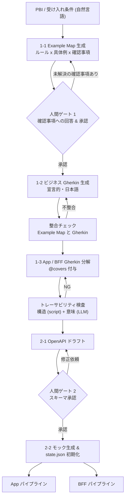
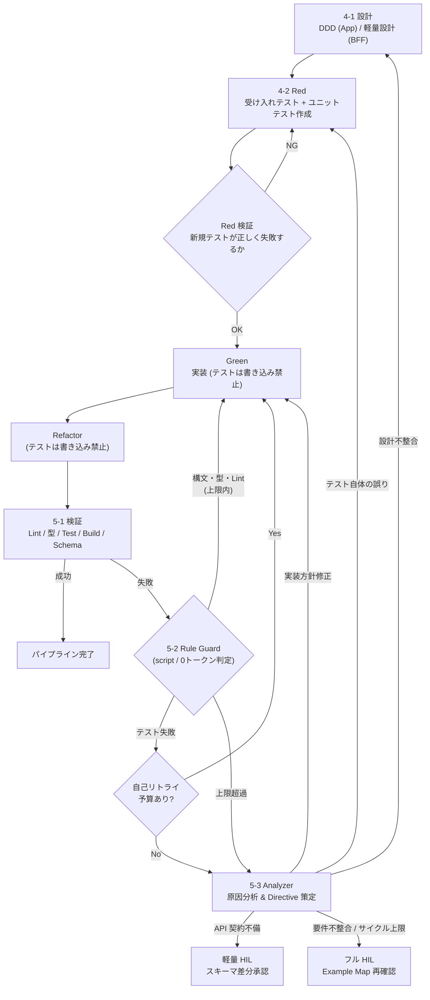
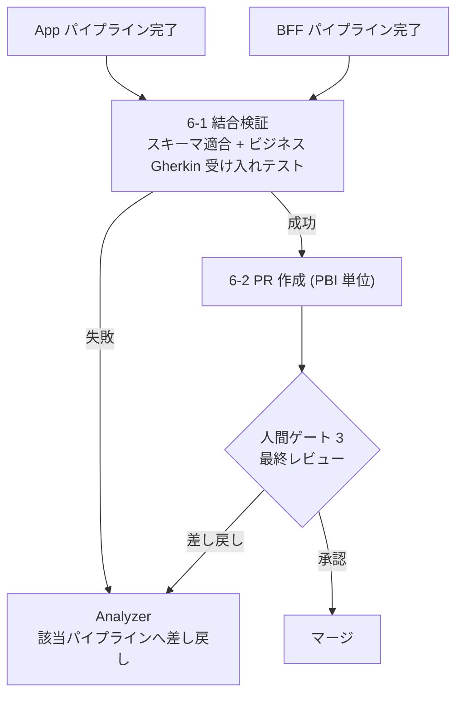
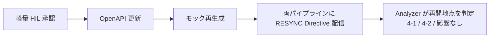

# AI-Driven Autonomous Development Workflow (v3.0)
〜 Example Mapping × BDD × DDD × TDD によるマルチエージェント協調開発パイプライン 〜

> v2.0 からの主な変更点
> - 人間のレビュー対象を **Gherkin → Example Map** に変更（Gherkin は機械用成果物）
> - **Guard（機械的強制）と Skill（判断の指針）を分離**。強制はhooks / CI / スクリプトで実装
> - 状態とカウンタは **決定論的オーケストレーター** が保持（`state.json`）。`plan.md` はビュー
> - **テスト誤りルート**（Red への差し戻し）、**Phase 6 の失敗ルート**、**スキーマ変更の同期** を追加
> - **初版スキーマの人間承認ゲート** を追加
> - Gherkin を **受け入れテストとして実行**（二重ループ TDD）
> - **Jev（軽量トリアージ層）を廃止**し、実装エージェントの自己リトライに置き換え
> - モデル名ではなく **ロール名** で定義（Fable → Analyzer）

---

## 0. 設計原則

| # | 原則 | 内容 |
| :--- | :--- | :--- |
| 1 | **人間ゲートは3つに絞る** | ① Example Map（要件） ② API スキーマ（契約） ③ PR（最終成果物） |
| 2 | **強制は仕組みで、指針はプロンプトで** | 守らせたいルールは hooks / CI / スクリプトで物理的に強制する。Skill は判断手順の提供に留める |
| 3 | **状態はLLMに持たせない** | フェーズ・リトライ回数・予算はオーケストレーターが管理する。LLM は状態を読むだけで、書き換えられない |
| 4 | **決定論的ファースト** | 機械で判定できるものは LLM に渡さない |
| 5 | **ロールとモデルを分離** | ロールで定義し、モデルの割り当ては設定ファイルで切り替える |
| 6 | **PBI 単位の縦切り** | 1 PBI = 1 パイプライン = 1 PR。コンテキストとレビュー負荷を抑える |
| 7 | **計測して調整** | KPI を最初から取り、層の追加・削除はデータで判断する |

---

## 1. ロールとモデル割り当て（初期値）

| ロール | 担当フェーズ | モデル（初期値） | 理由 |
| :--- | :--- | :--- | :--- |
| **Spec Agent** | 1-1 〜 1-3 | Gemini 3.8 Flash (High) | 曖昧さの発見と構造化が仕事。量が多いので速くて安いモデルに推論を厚めに |
| **Design Agent** | 2-1, 4-1 | Gemini 3.8 Flash (High) | スキーマ案・ドメイン設計。誤りは後工程に響くため High |
| **Implementer** | 4-2 (Red / Green / Refactor) | Gemini 3.8 Flash (Medium) | 回数が最も多い部分。コスト・速度重視 |
| **Analyzer**（旧 Fable） | 5-3, 6 の失敗時 | Claude Opus 5.5 (High) | 根本原因の分析と Directive の策定。**コードは書かない（読み取り専用）** |
| ~~Triage（旧 Jev）~~ | — | 初期は使わない | 自己リトライで代替。データを見てから導入を判断 → [ROADMAP](./ROADMAP.md) P3 |

> [!TIP]
> **調整ポイント**
> - 設計起因のエスカレーションが多い場合 → 4-1 の後に **Analyzer による設計レビュー** を挟む
> - 自己リトライの成功率が低い場合 → 2回目の自己リトライだけ **Implementer を High に昇格** させる（Analyzer より安い中間段階）

```yaml
# orchestrator/models.yaml（例）
roles:
  spec:        { model: gemini-3.8-flash, thinking: high }
  design:      { model: gemini-3.8-flash, thinking: high }
  implementer: { model: gemini-3.8-flash, thinking: medium, escalate_on_retry: high }
  analyzer:    { model: claude-opus-5.5,  thinking: high, write_access: false }
```

---

## 2. ワークフロー全体図

### 2-1. 仕様 → 契約（直列）



### 2-2. 担当別パイプライン（App / BFF それぞれ独立に実行）



### 2-3. 結合 → PR



### 2-4. スキーマ変更の同期



---

## 3. 各フェーズの詳細仕様

### Phase 1: 要件の具体化（Example Mapping → BDD）

#### 1-1. Example Map 生成（人間ゲート 1）
* **入力**: PBI（タイトル・説明・受け入れ条件を自然言語で）
* **Spec Agent の出力**: `specs/example-maps/{PBI-ID}.md`
  * **ルール**: 業務ルールを1行ずつ。各ルールに ID（`BIZ-001`）を付ける
  * **具体例**: ルールごとに正常・異常・境界の例を表で
  * **確認事項**: 曖昧な点・前提の抜け・矛盾。**AI が積極的に洗い出す**
* **人間の作業**: 全文を読んで承認するのではなく、**確認事項に回答し、具体例の表を確認する**
* **通過条件**: 未回答の確認事項が 0 件で、人間が承認していること

```markdown
# PBI-123: プロフィール更新

## BIZ-001: ニックネームは重複不可
| 具体例 | 期待結果 |
| :--- | :--- |
| 既存ユーザー「taro」と同じ名前に変更 | エラー「既に使われています」 |
| 自分の現在のニックネームのまま保存 | 成功（変更なし扱い） |

## BIZ-002: ニックネームは2〜20文字
| 具体例 | 期待結果 |
| :--- | :--- |
| 1文字 / 21文字 | エラー |
| 2文字 / 20文字 | 成功 |

## ❓ 確認事項
- [x] Q1. 大文字と小文字の違いは重複とみなすか？ → **A. 同一とみなす（taro = Taro）**
- [ ] Q2. 退会済みユーザーのニックネームは再利用できるか？
```

#### 1-2. ビジネス Gherkin 生成
* `specs/features/business/{PBI-ID}.feature` に、Example Map から生成する
* **書き方のルール**（Rule として常時適用）
  * `# language: ja` で日本語化
  * **宣言的に書く**（「ボタンを押す」ではなく「ニックネームを変更しようとする」）
  * `ルール:` 単位で BIZ-ID のタグを付ける。具体例が多い場合は `シナリオアウトライン` + `例:` の表を使う
* **整合チェック**: Example Map の全ルール・全具体例が Gherkin に反映されているかを LLM で照合する（漏れや余分があれば再生成）
* 人間は原則として読まない。PO が必要なときに確認できればよい

```gherkin
# language: ja
機能: プロフィール更新

  @BIZ-001
  ルール: ニックネームは重複不可
    シナリオ: 既に使われているニックネームには変更できない
      前提 "taro" というニックネームの会員が存在する
      もし 別の会員がニックネームを "Taro" に変更しようとする
      ならば "既に使われています" と通知される
```

#### 1-3. App / BFF Gherkin への分解
| 層 | 配置 | ルール |
| :--- | :--- | :--- |
| ビジネス層 | `specs/features/business/` | 1-2 で生成。`@BIZ-xxx` |
| App 層 | `specs/features/app/` | UI の状態変化・表示を展開。`@covers:BIZ-xxx` 必須 |
| BFF 層 | `specs/features/bff/` | エンドポイントの入出力・連携を展開。`@covers:BIZ-xxx` 必須 |

* **トレーサビリティ検査**
  * **構造チェック（スクリプト / Guard）**: `@covers` のないシナリオ、どこからも covers されていない BIZ を検出したら差し戻す
  * **意味チェック（LLM / Skill）**: ビジネス層の各「ならば」が、下位層のどこかで実際に検証されているかを照合する。タグだけ付いていて中身が伴わないケースを検出する

### Phase 2: 契約確定（Schema First）

#### 2-1. OpenAPI ドラフト（人間ゲート 2）
* Design Agent が BFF Gherkin から `specs/api/v1/*.yaml` のドラフト（既存のものがあれば差分）を作る
* **初版も人間が承認する**。App と BFF の両方が依存する契約なので、差分だけでなく初版にもゲートを置く
* `examples` を Example Map の具体例から埋める（モックとテストの共通データになる）

#### 2-2. モック生成 & 初期化
* **モック**: 型とハンドラーの雛形は OpenAPI から生成する。シナリオ（409 重複、状態遷移など）は **Example Map / Gherkin 由来の fixture** から生成する
  * 原則は「手書き禁止」ではなく **生成元の一元化**。fixture の追加は許可するが、ハンドラーの直接編集は禁止する
* **初期化**（オーケストレーター）: `tasks/{PBI-ID}/state.json`、`app/plan.md`、`bff/plan.md`、`audit.jsonl` を作る

### Phase 3: ディスパッチ
* オーケストレーターが App / BFF パイプラインを **独立に** 起動する
* エージェントは起動時に `plan.md`（現在の Directive と進捗）と Rules を読み込む
* 一方のパイプラインが失敗しても、もう一方は止めない（合流するのは Phase 6 だけ）

### Phase 4: 設計 & 二重ループ TDD

#### 4-1. 設計
* **App**: DDD（エンティティ・値オブジェクト・ユースケースの境界）
* **BFF**: マッピングと集約が中心なので **軽量設計**（DTO 変換・エラーマッピング・下流呼び出しの責務分割）に留める。ドメインロジックが BFF に漏れてきたら設計見直しのサイン
* 決定事項は `plan.md` の設計セクションに記録する（理由を1行添える）

#### 4-2. 二重ループ TDD
| ループ | 対象 | 実行タイミング |
| :--- | :--- | :--- |
| **外側** | App / BFF Gherkin の受け入れテスト（step definition） | Red で作成し、Phase 5 で毎回実行する |
| **内側** | ユニットテスト | Red / Green / Refactor のサイクルを回す |

* **Red**: 受け入れテストの step definition とユニットテストを作る（プロダクションコードは書き込み禁止）
  * **Red 検証**（オーケストレーター）: 新規テストが **アサーションで** 失敗すること、既存テストは通ることを確認する
* **Green**: 最小限の実装（**テストファイルは書き込み禁止**）
* **Refactor**: テストを通したまま整理する（**テストファイルは書き込み禁止**）
* **フェーズ別の書き込み権限**（Guard で強制。詳細は §5）

| フェーズ | テスト / step def | プロダクションコード | スキーマ / モック |
| :--- | :--- | :--- | :--- |
| Red | ✅ | ❌ | ❌ |
| Green | ❌ | ✅ | ❌ |
| Refactor | ❌ | ✅ | ❌ |

### Phase 5: 検証 & エスカレーション

#### 5-1. 検証
Lint・フォーマット・型チェック・ユニットテスト・受け入れテスト・ビルド・OpenAPI 適合（BFF の実レスポンスをスキーマで検証）

#### 5-2. Rule Guard（スクリプト）
* 終了コードとエラーパターンで分類し、LLM を介さずに差し戻し先を決める
* 構文・型・Lint エラーは、エラー出力を添えて Implementer に戻す（専用カウンタを使う）
* テスト失敗は、自己リトライ予算が残っていれば Implementer に戻し、尽きていれば Analyzer へ

#### 5-3. Analyzer（Opus 5.5 High / 読み取り専用）
* **入力**: 失敗ログ、関連コード、該当 Gherkin・Example Map、`plan.md`、直近の audit
* **出力**: 根本原因 + 振り分け先 + Directive（`plan.md` の Current Directive を上書きし、audit に追記）

| 振り分け | 条件 | 戻り先 |
| :--- | :--- | :--- |
| `RETRY_DESIGN` | ドメイン設計・責務境界の誤り | 4-1 |
| `RETRY_IMPL` | 実装方針の誤り | 4-2 Green |
| `FIX_TEST` | **テスト自体が仕様と食い違っている** | 4-2 Red（変更理由を audit に必ず記録） |
| `SCHEMA_CHANGE` | プロパティ不足・型表現の不備 | 軽量 HIL（スキーマ差分 PR）→ §2-4 の同期 |
| `ESCALATE_HUMAN` | 要件の矛盾、またはサイクル上限 | フル HIL（Example Map 再確認） |

#### 5-4. リトライ & サーキットブレーカー（オーケストレーターが管理）
| カウンタ | 上限（初期値） | 上限を超えたら | リセット条件 |
| :--- | :--- | :--- | :--- |
| `rule_guard` | 5 | Analyzer | 新しい Directive が出たとき |
| `self_retry`（テスト失敗） | 2 | Analyzer | 新しい Directive が出たとき |
| `analyzer_cycles` | 3 | フル HIL | リセットしない（タスク単位） |
| `token_budget`（PBI 単位） | 設定値 | 一時停止して人間に通知 | — |

### Phase 6: 結合 & PR

#### 6-1. 結合検証
* **スキーマ適合**: App が送るリクエストと BFF が返すレスポンスを、どちらも OpenAPI で検証する（schemathesis などを想定）
  * Pact は **初期は導入しない**。スキーマファーストの検証で足りるかを見てから判断する
* **ビジネス Gherkin の受け入れテスト**: 結合環境（または E2E）で実行する
* 失敗したら Analyzer が該当パイプラインへ差し戻す

#### 6-2. PR（人間ゲート 3）
* **1 PBI = 1 PR**
* PR 本文: 変更の要約、Example Map へのリンク、`BIZ-ID → シナリオ → テスト → 実装` の対応表、Analyzer の介入履歴（audit の要約）、確定した `plan.md`
* レビューで差し戻されたら Analyzer がコメントを Directive に変換する

---

## 4. 状態管理ファイル

### ディレクトリ構成
```
specs/
  example-maps/{PBI-ID}.md        # 人間ゲート1の対象
  features/{business,app,bff}/    # Gherkin
  api/v1/*.yaml                   # 人間ゲート2の対象
  mocks/fixtures/                 # シナリオ fixture（生成元）
tasks/{PBI-ID}/
  state.json                      # オーケストレーター専用（エージェントは読み取りのみ）
  app/plan.md                     # ビュー + Current Directive
  bff/plan.md
  audit.jsonl                     # 追記専用ログ
orchestrator/                     # 状態機械・Rule Guard・モデル設定
.agents/                          # Antigravity: hooks.json / skills / rules
.claude/                          # Claude Code: settings.json (hooks/permissions) / skills
```

### `state.json`（正となる状態）
```json
{
  "pbi": "PBI-123",
  "stage": "PARALLEL",
  "pipelines": {
    "app": {
      "phase": "GREEN",
      "status": "IN_PROGRESS",
      "counters": { "rule_guard": 1, "self_retry": 0, "analyzer_cycles": 1 },
      "directive_id": "D-003"
    },
    "bff": {
      "phase": "DONE",
      "status": "COMPLETED",
      "counters": { "rule_guard": 0, "self_retry": 1, "analyzer_cycles": 0 },
      "directive_id": null
    }
  },
  "limits": { "rule_guard": 5, "self_retry": 2, "analyzer_cycles": 3, "token_budget": 2000000 },
  "usage": { "tokens": 412000 }
}
```

### `plan.md`（エージェント向けビュー）
* フロントマターとフェーズ進捗は **オーケストレーターが state.json から生成する**
* エージェントが書けるのは **設計の決定事項** と **作業メモ** のみ
* `Current Directive` は Analyzer だけが上書きする

```markdown
# PBI-123 / App

## 前提リソース
- Example Map: specs/example-maps/PBI-123.md
- Gherkin: specs/features/app/profile_update.feature
- OpenAPI: specs/api/v1/user.yaml (Read-Only)
- Mock: specs/mocks/ (生成物 / Read-Only)

## 進捗 (auto-generated)
- [x] 4-1 設計  - [x] Red  - [/] Green  - [ ] Refactor  - [ ] 検証

## 設計の決定事項
- Nickname は値オブジェクト。正規化（小文字化）をコンストラクタで行う — BIZ-001 Q1 の回答に基づく

## Current Directive (D-003 / Analyzer)
- 409 (nickname_conflict) を受けた際の Presenter 分岐が未実装。
- スキーマ・テストの変更は禁止。Presenter のエラーマッピングのみ追加すること。
```

### `audit.jsonl`（追記専用）
```json
{"ts":"2026-10-06T20:30:15+09:00","actor":"rule_guard","pipeline":"app","event":"TS2304","action":"RETRY_IMPL"}
{"ts":"2026-10-06T20:32:00+09:00","actor":"orchestrator","pipeline":"app","event":"assertion_failed","detail":"expected 409, got 500","action":"SELF_RETRY"}
{"ts":"2026-10-06T20:35:40+09:00","actor":"analyzer","pipeline":"app","root_cause":"missing presenter branch for 409","action":"RETRY_IMPL","directive":"D-003"}
```

---

## 5. Guard（強制）と Skill（指針）の分担

### Guard: 仕組みで強制するもの
| 制御 | 実装手段 |
| :--- | :--- |
| **Red / Green 権限分離** | ① PreToolUse hook: ファイル編集ツールを `state.json` のフェーズとパスに応じて `deny` にする ② **フェーズ終了時の git diff 検査**: シェル経由の書き込みなど hook をすり抜けた変更を検出したら、ロールバックして差し戻す |
| **スキーマ / モック保護** | hook + CI（`specs/api/**` の変更は `schema-change` ラベル付き PR のみ許可）+ CODEOWNERS |
| **Rule Guard** | オーケストレーター内のスクリプト（LLM は呼ばない） |
| **リトライ / サーキットブレーカー / 予算** | オーケストレーター |
| **トレーサビリティ構造検査** | Gherkin パーサーを使ったスクリプト |
| **Red 検証** | オーケストレーター（失敗理由がアサーションかどうかを判定） |
| **マージ保護** | ブランチ保護（CI 必須・人間の承認必須） |

```jsonc
// .agents/hooks.json（Antigravity の例 / Claude Code は .claude/settings.json の hooks に相当するものを書く）
{
  "tdd-isolation": {
    "PreToolUse": [
      {
        "matcher": "write_to_file|replace_file_content",
        "hooks": [{ "type": "command", "command": "node orchestrator/guards/tdd-isolation.js", "timeout": 5 }]
      }
    ]
  }
}
// tdd-isolation.js: stdin の toolCall.args から対象パスを取り出し、state.json の phase と照合して
//                   {"decision":"deny","reason":"Green フェーズではテストを編集できません"} を返す
```

### Skill / Rule: 判断の手順として提供するもの
| 名前 | 種別 | 内容 |
| :--- | :--- | :--- |
| `example-mapping` | Skill | PBI から Example Map を作る手順。確認事項の洗い出し観点（境界・権限・状態・並行性・削除時の扱い） |
| `gherkin-style` | Rule | 宣言的・日本語・ルール単位でのタグ付け |
| `spec-decomposition` | Skill | ビジネス Gherkin を App / BFF に分解する手順と `@covers` の付け方 |
| `semantic-coverage` | Skill | 「ならば」の検証箇所を照合する手順 |
| `domain-design` | Skill | App 向け DDD / BFF 向け軽量設計の手順 |
| `tdd-cycle` | Skill | Red / Green / Refactor それぞれの作法 |
| `analyzer` | Skill | 原因分析の観点、振り分け基準、Directive のフォーマット |

---

## 6. KPI（最初から計測する）

| KPI | 意味 | 使い道 |
| :--- | :--- | :--- |
| PBI あたりトークン / 時間 | コスト | モデル割り当ての調整 |
| 自己リトライ成功率 | Implementer の自力解決率 | 低ければ High への昇格や Triage 層の検討 |
| Analyzer 介入率と振り分け内訳 | どこで詰まっているか | 設計起因が多ければ設計レビューを追加 |
| `FIX_TEST` の発生率 | Red の品質 | 高ければ Red に Analyzer レビューを追加 |
| 人間ゲート 1 の確認事項数・回答時間 | 形だけの承認になっていないか | 確認事項 0 件が続くなら Skill を見直す |
| 後工程からの要件差し戻し率 | Example Map の品質 | 高ければゲート 1 を強化 |
| PR レビュー時間・差し戻し率 | 最終成果物の品質 | PBI の粒度を見直す |

---

## 7. 運用ルール

| 項目 | ルール |
| :--- | :--- |
| 粒度 | 1 PBI の Example Map がルール 3〜7 個に収まらなければ PBI を分割する |
| コンテキスト衛生 | エージェントに渡すのは `plan.md` + 関連 spec のみ。audit は Analyzer だけが読む |
| テスト変更 | Red 以外ではテストを変更しない。`FIX_TEST` は理由付きで audit に残し、PR に明記する |
| スキーマ変更 | 必ず軽量 HIL を通す。承認後は両パイプラインに RESYNC を出す |
| 層の追加 | Triage 層・Pact・設計レビューなどは KPI で必要性が示されてから追加する |
